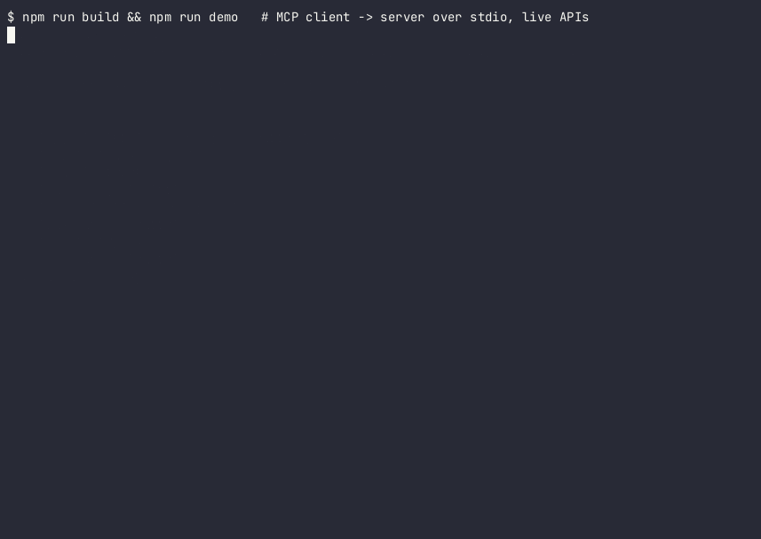

# mcp-french-open-data

[Français](README.fr.md) · English

An [MCP](https://modelcontextprotocol.io) server that gives AI assistants (Claude, Cursor, ChatGPT, …) typed, read-only access to French public open data. It covers addresses, companies and communes. All the APIs it wraps are free and keyless.



It is a small but complete reference implementation:
- **Tools:** 5 read-only tools with validated input (zod) and descriptions written for models.
- **Transports:** stdio, plus stateless **Streamable HTTP** with API-key auth.
- **Operations:** structured JSON logs on stderr, upstream timeouts, readable error mapping, and polite per-API rate limiting.
- **Tests:** unit tests with mocked HTTP, protocol tests through the official SDK client, and an opt-in live smoke test.

## Tools

| Tool | What it does | Upstream |
|---|---|---|
| `search_address` | Geocodes a free-text French address. Returns ranked matches with postcode, INSEE code, score and coordinates. | IGN Géoplateforme geocoding (BAN) |
| `reverse_geocode` | Finds the nearest addresses to a lat/lon, with their distance in metres. | IGN Géoplateforme geocoding (BAN) |
| `search_company` | Searches companies by name, address, leader or SIREN/SIRET, with postcode, département, NAF and active-only filters. | API Recherche d'entreprises (SIRENE/RNE) |
| `get_company` | Returns one company by SIREN: legal form, VAT number, head office, leaders and published revenue/net income. | API Recherche d'entreprises |
| `list_communes` | Lists communes by name, postcode or département, with INSEE code, postcodes and population. | geo.api.gouv.fr |

Every tool is annotated `readOnlyHint: true`. Upstream failures come back as tool errors (`isError: true`) with a readable message, for example `Recherche d'entreprises rate limit reached; retry after 5 s.`. They never surface as raw stack traces.

### Upstream APIs and limits

| API | Base URL | Published limit | This server |
|---|---|---|---|
| [Géoplateforme geocoding](https://www.data.gouv.fr/dataservices/api-geoplateforme-geocodage) | `https://data.geopf.fr/geocodage/` | 50 req/s per IP | ≤ 40 req/s |
| [Recherche d'entreprises](https://recherche-entreprises.api.gouv.fr/docs/) | `https://recherche-entreprises.api.gouv.fr/` | 7 req/s per IP | ≤ 5 req/s |
| [Découpage administratif](https://geo.api.gouv.fr/decoupage-administratif) | `https://geo.api.gouv.fr/` | — | ≤ 20 req/s |

The BAN address API at `api-adresse.data.gouv.fr` was retired in January 2026 and replaced by the IGN Géoplateforme service, which this server uses. The limits are applied per process. Company data excludes non-public ("non-diffusible") entities. Leaders' birth dates, which the upstream returns, are not passed on.

## Install and run

Requires Node.js ≥ 20.

```bash
git clone https://github.com/maelguimet/mcp-french-open-data.git
cd mcp-french-open-data
npm ci
npm run build

# stdio (for local clients such as Claude Desktop or Cursor)
node dist/index.js

# Streamable HTTP on http://127.0.0.1:3000/mcp
export MCP_API_KEY="$(openssl rand -hex 32)"
npm run start:http
```

Try it without an AI client: `npm run demo` connects the bundled SDK client over stdio and calls every tool. Use `npm run demo -- --http http://127.0.0.1:3000/mcp` for HTTP; it reads `MCP_API_KEY`. The real output is in [docs/demo.md](docs/demo.md).

With Docker:

```bash
docker build -t mcp-french-open-data .
docker run --rm -p 3000:3000 -e MCP_API_KEY -e ALLOWED_HOSTS=localhost,127.0.0.1 mcp-french-open-data
```

## Client configuration

### Claude Desktop (stdio)

Edit `claude_desktop_config.json`. On macOS it is in `~/Library/Application Support/Claude/`; on Windows, in `%APPDATA%\Claude\`.

```json
{
  "mcpServers": {
    "french-open-data": {
      "command": "node",
      "args": ["/absolute/path/to/mcp-french-open-data/dist/index.js"]
    }
  }
}
```

### Cursor

Edit `~/.cursor/mcp.json`, or `.cursor/mcp.json` in a project. You can use stdio:

```json
{
  "mcpServers": {
    "french-open-data": {
      "command": "node",
      "args": ["/absolute/path/to/mcp-french-open-data/dist/index.js"]
    }
  }
}
```

or the HTTP server with the API key:

```json
{
  "mcpServers": {
    "french-open-data": {
      "url": "http://127.0.0.1:3000/mcp",
      "headers": { "Authorization": "Bearer ${env:MCP_API_KEY}" }
    }
  }
}
```

### ChatGPT

ChatGPT only connects to **remote** MCP servers, through a **public HTTPS URL** or OpenAI's Secure MCP Tunnel. It cannot use a local stdio server. Its connection settings offer **OAuth** or **No authentication**; they don't offer a custom API key header. So:

1. Deploy the HTTP server behind HTTPS, for example with the Docker image behind a reverse proxy. Set `ALLOWED_HOSTS` to your domain.
2. Because the data is public and every tool is read-only, you can start it with `MCP_AUTH=none` (no key). This is an explicit opt-in; without it, the server refuses to start with no key.
3. In ChatGPT, open **Plugins → + → Add custom MCP server**. Enter `https://your-domain/mcp`, choose **No authentication**, acknowledge the warning and select **Create as a plugin**. Then install the plugin.

For the OpenAI **Responses API**, use an `mcp` tool with `server_url` set to your public URL. The `authorization` value is sent as a bearer token, so the API key should work there. See the [OpenAI MCP docs](https://developers.openai.com/api/docs/guides/custom-mcp-server). The menu names are taken from those docs (October 2026) and may change.

## Environment variables

| Variable | Default | Purpose |
|---|---|---|
| `MCP_TRANSPORT` | `stdio` | `stdio` or `http`. `--http` on the command line also selects HTTP. |
| `MCP_API_KEY` | — | Required for HTTP; at least 16 characters. Accepted as `Authorization: Bearer <key>` or `x-api-key: <key>`. |
| `MCP_AUTH` | — | Set to `none` to serve HTTP without a key, as an explicit opt-in. |
| `HOST` / `PORT` | `127.0.0.1` / `3000` | HTTP bind address. |
| `ALLOWED_HOSTS` | — | Comma-separated `Host` allow-list (DNS-rebinding protection) when binding to `0.0.0.0`. |
| `LOG_LEVEL` | `info` | `debug`, `info`, `warn` or `error`. Logs go to stderr as JSON lines. |
| `GEOCODING_BASE_URL`, `ENTREPRISES_BASE_URL`, `GEO_BASE_URL` | public endpoints | Override the upstreams, e.g. for a proxy or cache. |

See [.env.example](.env.example).

## Security

- **Authentication:** the HTTP transport requires an API key by default. Keys are compared in constant time (SHA-256 digests compared with `crypto.timingSafeEqual`). Requests without a valid key get `401` and a `WWW-Authenticate` header. stdio needs no key, because it only talks to the process that launched it.
- **Statelessness:** HTTP is stateless. Each request gets a fresh server and transport, so clients share no state.
- **Binding:** by default the server binds to `127.0.0.1`, with the SDK's DNS-rebinding protection. On `0.0.0.0`, put it behind TLS and set `ALLOWED_HOSTS`.
- **Scope:** every tool is read-only over public data. No credentials for any upstream are stored or needed.
- **Validation and logging:** inputs are validated before any network call (e.g. a SIREN must have 9 digits). Logs record the tool, the upstream status and the latency, never the API key.
- Keep `.env` out of version control. It is in `.gitignore`.

## Development

```bash
npm run lint        # ESLint (typescript-eslint)
npm run typecheck   # tsc on src, tests and scripts
npm test            # vitest: mocked HTTP + MCP protocol tests (no network)
npm run test:live   # opt-in smoke test against the real APIs (LIVE=1)
npm run build       # compile to dist/
```

## License

[MIT](LICENSE) © 2026 Maël Guimet. Data comes from French public services under their open licences: Licence Ouverte / Etalab 2.0 for BAN, SIRENE and geo.api.gouv.fr.
